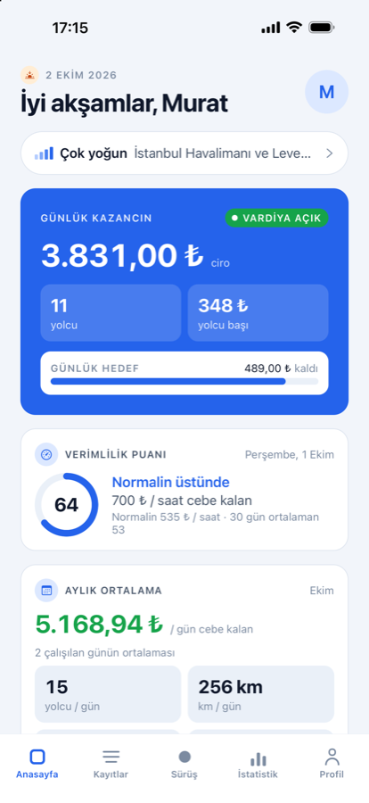
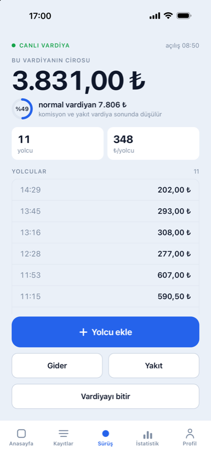
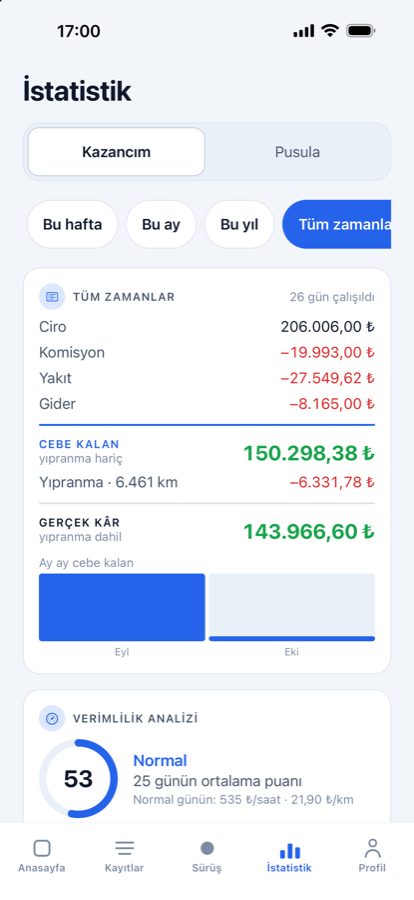
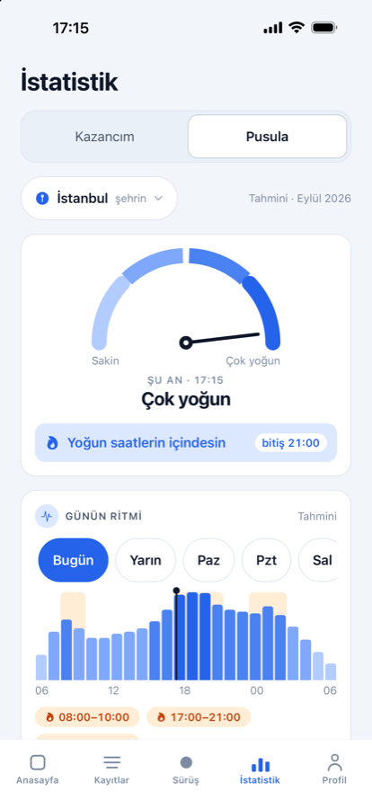
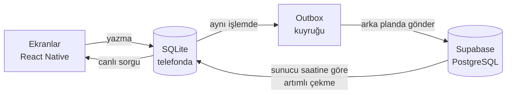

# Sürücüm

Kendi arabasıyla, bir uygulama üzerinden çalışan sürücüler için kazanç,
gider ve **aracın gerçek maliyetini** takip eden iOS + Android uygulaması.
App Store'da yayında; Türkçe arayüz.


<p align="center">
  
  
  
  
</p>

## Neden var

Sürücüler günün sonunda ellerinde kalan parayı kâr sanıyor; aracın her
kilometrede yıprandığını ve değer kaybettiğini hesaba katmıyor. Sürücüm tek
bir "kâr" rakamı yerine her yerde üç satır gösterir:

| | |
|---|---|
| **Ciro** | Brüt hasılat |
| **Cebe kalan** | Ciro − komisyon − yakıt − gider |
| **Gerçek kâr** | Cebe kalan − aracın km başına yıpranma payı |

Yıpranma payı, kurulumda sorulan bakım maliyeti, lastik ömrü ve aracın
ikinci el değerinden hesaplanır.

## Özellikler

- **Sürüş:** tek tuşla vardiya aç, her yolcuyu tek alanla (tutar) kaydet.
  Araç hareket hâlindeyken tek elle kullanılacak şekilde tasarlandı.
- **Anasayfa:** günlük kazanç, aylık ortalama, verimlilik puanı, son 7 gün.
- **Kayıtlar:** vardiya vardiya döküm.
- **İstatistik → Kazancım:** dönem özeti, verimlilik, sıcak saatler,
  yolcu, km ve gider analizi.
- **İstatistik → Pusula:** İstanbul, Ankara, İzmir ve Antalya için şehrin
  tahmini yoğun saatleri, günleri ve bölgeleri.
- **Profil:** araçlar, günlük hedef, açık/koyu tema, geri bildirim,
  hesap silme.

## Teknoloji

| Katman | Kullanılan |
|---|---|
| Mobil uygulama | React Native, Expo, Expo Router, TypeScript |
| Arayüz | Reanimated, Gesture Handler, react-native-svg (grafikler) |
| Telefondaki veritabanı | SQLite (expo-sqlite) + Drizzle ORM |
| Bulut | Supabase: PostgreSQL, Auth, RLS, Edge Functions, pg_cron |
| Test ve CI | node:test, tsc, ESLint, GitHub Actions |
| Yayın | Xcode, Gradle, EAS Update (mağazasız güncelleme) |

## Mimari



**İnternetsiz öncelikli (offline-first).** Arayüz hiçbir zaman ağ
çağrısını beklemez. Her kayıt önce telefondaki SQLite'a yazılır ve ekran o
anda güncellenir; senkron arka planda yapılır.

- Senkronlanan bir tabloya yapılan her yazma, **aynı veritabanı işlemi
  içinde** outbox kuyruğuna da eklenir. Böylece hiçbir kayıt buluta gitmeden
  kaybolmaz.
- Kimlikler cihazda **UUID v7** olarak üretilir; kayıt internet yokken de
  kalıcı kimliğine sahiptir.
- Silme yumuşaktır (`deleted_at`). Sert silme, başka bir cihazın eski kopyayı
  geri gönderip kaydı diriltmesine yol açardı.
- Çakışmada son yazan kazanır; bu kural istemcide değil, **sunucudaki bir
  tetikleyicide** uygulanır.
- Buluttan çekme imleci **sunucu saatidir**; saati yanlış bir telefon kayıt
  kaçırmaz.

**Para hesabı.** Hiçbir tutar `float` değildir. Tutarlar tam sayı kuruş,
oranlar baz puan olarak tutulur. Bölme işlemleri kuruş kaybetmeyen bir
paylaştırma fonksiyonuyla yapılır; aylık rapor günlerin toplamıyla birebir
tutar.

**İş günü takvim gününden farklıdır.** Gece 22:00'de başlayıp sabah 06:00'da
biten vardiya tek bir iş günü sayılır; o vardiyadaki her kayıt vardiyanın
gününe yazılır.

**Güvenlik.** Bulutta her tabloda satır düzeyinde güvenlik (RLS) vardır:
kullanıcı yalnızca kendi verisini okuyup yazabilir. Hesap silme, oturum
jetonunu doğrulayan bir Edge Function ile yapılır ve kullanıcının bütün
verisini zincirleme siler. Yumuşak silinen kayıtlar her gece çalışan bir
`pg_cron` işiyle 85 gün sonra kalıcı olarak temizlenir.

**Test edilebilirlik.** Bütün hesaplar (`src/lib`) veritabanından bağımsız
saf fonksiyonlardır. 720 birim testi, telefon ya da simülatör gerektirmeden
doğrudan Node ile birkaç saniyede koşar. Telefondaki ve buluttaki şemanın
sütun sütun aynı olduğunu da bir test denetler.

## Klasör yapısı

```
src/
  app/            Ekranlar (Expo Router): giriş, kurulum sihirbazı, sekmeler
  components/     Arayüz bileşenleri
  db/
    schema/       Veritabanı şeması (Drizzle)
    repo/         Okuma ve yazma katmanı
  lib/            Saf hesaplar: para, iş günü, kâr, yakıt, yıpranma, istatistik
  sync/           Outbox gönderimi, artımlı çekme, zamanlayıcı
  theme/          Renk ve tipografi belirteçleri, açık/koyu tema
supabase/
  migrations/     PostgreSQL şeması, RLS politikaları, tetikleyiciler
  functions/      Edge Function (hesap silme)
drizzle/          Telefondaki SQLite migration'ları
plugins/          Expo derleme eklentileri (iOS sahne yaşam döngüsü, imzalama)
tools/            Test yardımcıları (bellek içi veritabanı, Supabase taklidi), güvenlik denetimi
```

## Çalıştırmak

```bash
npm install
npm start            # geliştirme sunucusu
npx expo run:ios     # simülatörde derle ve aç
npm test             # birim testleri
npm run typecheck    # tip denetimi
```

Kök dizinde `.env` gerekli (`EXPO_PUBLIC_SUPABASE_URL`,
`EXPO_PUBLIC_SUPABASE_PUBLISHABLE_KEY`).

## In English

**Sürücüm** is an earnings and vehicle-cost tracker for rideshare drivers who
use their own car (iOS & Android, live on the App Store). Instead of a single
"profit" figure it shows gross revenue, take-home cash and true profit after
per-km vehicle wear.

Built with React Native, Expo and TypeScript. Offline-first: every write goes
to on-device SQLite (Drizzle ORM) and is queued in a transactional outbox,
then synced in the background to Supabase (PostgreSQL) with server-enforced
last-write-wins and row-level security. Money is stored as integer minor
units; all business logic is pure and covered by 720 unit tests running on
GitHub Actions.

## Lisans

Kaynak kod incelenmek üzere herkese açıktır. Kopyalanması, yeniden
kullanılması ya da dağıtılması yazılı izin gerektirir. Tüm hakları saklıdır.

Marka logoları [car-logos-dataset](https://github.com/filippofilip95/car-logos-dataset)
(MIT) paketinden alınmıştır; logolar ilgili markaların tescilli malıdır.
